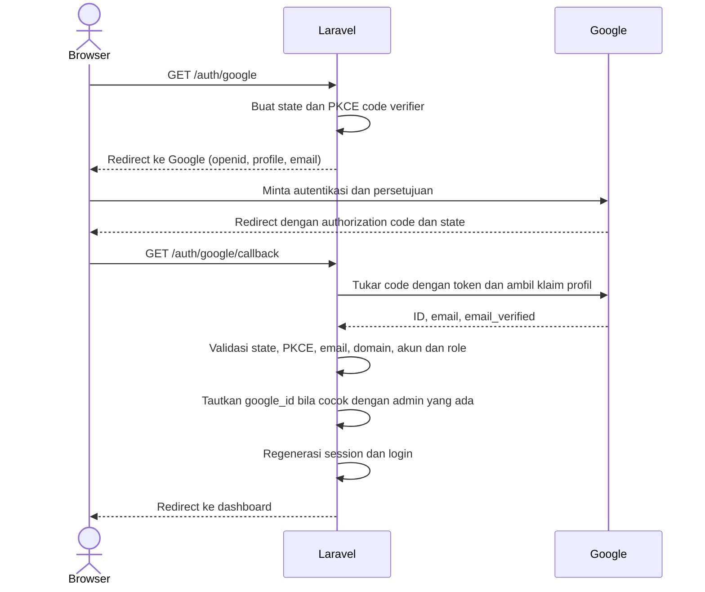
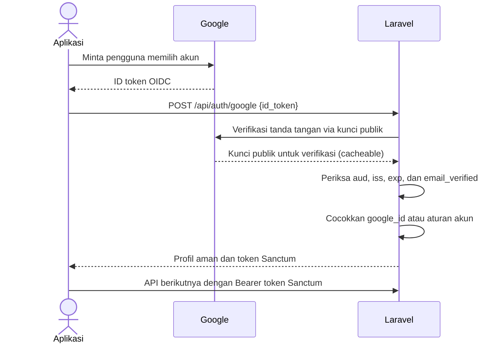

# Masuk dengan Google (SSO)

## Pengertian singkat

Single Sign-On (SSO) memungkinkan admin menggunakan akun Google yang sudah
terdaftar pada Berry Care untuk masuk tanpa mengetik password dashboard.
Google membuktikan identitasnya; Laravel tetap memeriksa akun dan role lokal.
SSO tidak mendaftarkan akun baru secara otomatis.

## Alur login



## Aturan akses

| Kondisi | Hasil |
|---|---|
| Email Google terverifikasi cocok dengan akun lokal ber-role `admin` | Login diizinkan; `google_id` ditautkan pada login pertama |
| `google_id` sudah tertaut | Akun dicari berdasarkan `google_id` |
| Email tidak ditemukan atau akun bukan admin | Ditolak dengan pesan umum `Akun Google ini tidak memiliki akses.` |
| Email belum terverifikasi | Ditolak dengan pesan umum yang sama |
| Email cocok, tetapi `google_id` sudah milik identitas berbeda | Ditolak dengan pesan umum yang sama |
| `GOOGLE_ALLOWED_DOMAIN` diisi dan domain email berbeda | Ditolak dengan pesan umum yang sama |
| Pengguna membatalkan persetujuan | Dikembalikan ke halaman login dengan pesan ramah |

## Pengaturan keamanan yang diterapkan

- OAuth stateful menggunakan `state` bawaan Socialite untuk mengikat callback
  ke sesi awal.
- PKCE `S256` aktif untuk authorization code flow.
- Meminta scope `openid`, `profile`, dan `email`; meminta pemilihan akun lewat
  `prompt=select_account`.
- Login hanya menerima klaim `email_verified: true`.
- Tidak ada pembuatan akun otomatis; akun yang dicocokkan harus sudah ada dan
  memiliki role `admin`.
- `google_id` unik, nullable, dan hanya ditautkan setelah seluruh pemeriksaan
  akses lolos.
- Session diregenerasi sebelum login. `Auth::login` dipanggil tanpa opsi
  remember-me.
- Kedua route SSO hanya dapat diakses guest dan dibatasi 10 request per menit.
- Callback mencatat hasil dengan IP dan email tersamarkan. Detail kegagalan
  teknis disimpan di log, bukan ditampilkan kepada pengguna.
- Access token maupun refresh token Google tidak disimpan oleh aplikasi.

## Google Cloud Console

1. Buka Google Cloud Console, pilih atau buat project, lalu konfigurasi OAuth
   consent screen. Isi nama aplikasi dan informasi kontak yang dibutuhkan.
2. Pada **APIs & Services → Credentials**, buat OAuth client ID bertipe **Web
   application**.
3. Tambahkan origin aplikasi pada **Authorized JavaScript origins** jika
   diperlukan oleh konfigurasi deployment.
4. Tambahkan callback Laravel yang persis sama dengan nilai
   `GOOGLE_REDIRECT_URI` pada **Authorized redirect URIs**. Untuk lokal,
   contoh nilai default-nya `http://localhost/auth/google/callback` jika
   `APP_URL=http://localhost`; sesuaikan port dan host aplikasi yang dijalankan.
5. Salin client ID dan client secret ke `GOOGLE_CLIENT_ID` dan
   `GOOGLE_CLIENT_SECRET` di `web/.env` lokal. Jangan commit atau mengirim
   secret ke repository.
6. Isi `GOOGLE_REDIRECT_URI` bila URL callback berbeda dari default
   `APP_URL/auth/google/callback`. Isi `GOOGLE_ALLOWED_DOMAIN` dengan domain
   yang diperbolehkan, atau biarkan kosong jika tidak membatasi domain.
7. Pastikan tabel users sudah memiliki akun admin dengan email Google yang
   telah diverifikasi. Jalankan migrasi aplikasi agar kolom `google_id` tersedia.
8. Di Google OAuth consent screen, tambahkan akun penguji bila aplikasi masih
   berstatus testing. Untuk production, selesaikan verifikasi dan publikasi
   aplikasi sesuai persyaratan Google.

## Pengujian

Feature tests memakai mock Socialite, jadi tidak membutuhkan kredensial Google
atau koneksi ke Google. Untuk uji manual, konfigurasi credential lokal sesuai
langkah di atas, jalankan Laravel, lalu pilih **Masuk dengan Google** pada
halaman login.

## SSO di aplikasi mobile

Aplikasi Flutter tidak memercayai nama atau email yang dikembalikan langsung
oleh pemilih akun. Aplikasi hanya meneruskan ID token ke Laravel; server
memverifikasi tanda tangan token dengan kunci publik Google dan memeriksa
klaim sebelum menerbitkan token Sanctum.



### Aturan akun API

| Kondisi | Hasil |
|---|---|
| `google_id` cocok dengan subjek token terverifikasi | Login ke akun yang tertaut |
| Email belum ada dan `GOOGLE_AUTO_REGISTER=true` | Akun baru dibuat dengan role `petani` |
| Email belum ada dan auto-register mati | `403`, diminta menghubungi admin |
| Email sudah ada tetapi belum punya `google_id` | `409`; tidak ditautkan otomatis, gunakan login password |
| ID token, audience, issuer, kedaluwarsa, atau verifikasi email tidak valid | `401` dengan pesan umum |
| Token kosong atau lebih dari 8192 karakter | `422` dengan detail validasi |

### Pengaturan keamanan mobile

- Tanda tangan ID token diverifikasi di Laravel memakai `Google\Client::verifyIdToken`
  dan kunci publik Google; API tidak menggunakan endpoint `tokeninfo`.
- Audience harus sama persis dengan `GOOGLE_CLIENT_ID` (OAuth Web client ID).
- Issuer harus `accounts.google.com` atau `https://accounts.google.com`;
  `exp` harus masih berlaku dan `email_verified` harus bernilai true.
- Akun yang sudah ada tanpa `google_id` tidak ditautkan otomatis.
- Auto-register, bila diaktifkan, selalu menetapkan role `petani`; role dari
  request diabaikan. Flag `GOOGLE_AUTO_REGISTER` harus tetap false di produksi.
- Tiap percobaan dicatat dengan IP, user agent yang dipotong, alasan, dan
  email tersamarkan; ID token tidak dicatat.
- Route dibatasi 10 request per menit per IP. Respons login menggunakan
  `Cache-Control: no-store`; profil tidak memuat password atau `google_id`.
- Token Sanctum dipakai untuk API lanjutan dan dicabut saat logout. Mobile tidak
  menyimpan access/refresh token Google.

### Konfigurasi Google Cloud Console untuk Android

1. Konfigurasikan OAuth consent screen. Isi informasi aplikasi dan publikasikan
   consent screen sebelum mendistribusikan aplikasi secara luas; selama status
   testing, tambahkan akun penguji di daftar test users.
2. Buat OAuth client ID bertipe **Android**. Gunakan package
   `com.berrycare.fieldapp` dan SHA-1 sertifikat yang menandatangani APK.
   Untuk debug lokal, SHA-1 dapat dilihat dengan
   `cd mobile/android; .\gradlew signingReport`. Tambahkan SHA-1 berbeda untuk
   setiap jenis sertifikat/build yang digunakan.
3. Buat atau gunakan OAuth client ID bertipe **Web application**. Nilai inilah
   yang menjadi `GOOGLE_CLIENT_ID` di `web/.env` dan
   `GOOGLE_SERVER_CLIENT_ID` pada build Flutter; keduanya harus sama agar
   klaim `aud` cocok.
4. Isi `GOOGLE_CLIENT_ID` di `web/.env` lokal dan pilih apakah
   `GOOGLE_AUTO_REGISTER=true` hanya untuk pengembangan. Jangan masukkan
   secret atau ID klien ke repository.
5. Jalankan aplikasi Flutter di Android dengan URL API yang dapat dijangkau
   perangkat dan server client ID:

   ```powershell
   cd mobile
   flutter run -d <android-device-id> `
     --dart-define=API_URL=http://10.0.2.2:8000/api `
     --dart-define=GOOGLE_SERVER_CLIENT_ID=<web-client-id>
   ```

   `10.0.2.2` hanya untuk emulator Android; perangkat fisik perlu URL host LAN
   yang dapat dijangkau, dan deployment harus memakai HTTPS.

### Menjalankan SSO di Chrome

1. Gunakan OAuth client bertipe **Web application** yang sama untuk
   `GOOGLE_CLIENT_ID` backend dan `GOOGLE_SERVER_CLIENT_ID` Flutter.
2. Pada Authorized JavaScript origins, tambahkan `http://localhost` dan
   `http://localhost:7357` untuk pengembangan lokal. Host dan port harus
   sama persis dengan URL yang dibuka di browser.
3. Jalankan Laravel pada port 8000, lalu mulai Flutter Web dengan port tetap:

   ```powershell
   cd mobile
   flutter run -d chrome --web-hostname localhost --web-port 7357 `
     --dart-define=API_URL=http://localhost:8000/api `
     --dart-define=GOOGLE_SERVER_CLIENT_ID=<web-client-id>
   ```

4. Di Chrome, Flutter merender tombol resmi dari Google Identity Services
   melalui `google_sign_in_web`. Library menerima OAuth `clientId`, bukan
   `serverClientId`, di web. Otorisasi JavaScript origin harus cocok dengan
   alamat browser. Untuk production, atur `CORS_ALLOWED_ORIGINS` Laravel sesuai
   origin HTTPS aplikasi dan gunakan HTTPS untuk API.

### Batas platform

Implementasi dan konfigurasi yang disiapkan untuk tugas ini ditujukan untuk
Android. Integrasi iOS memerlukan OAuth iOS client ID serta URL scheme di
konfigurasi Runner, dan belum disiapkan atau diuji. Chrome mendukung tombol
SDK apabila web client ID dan JavaScript origins dikonfigurasi seperti di atas.
