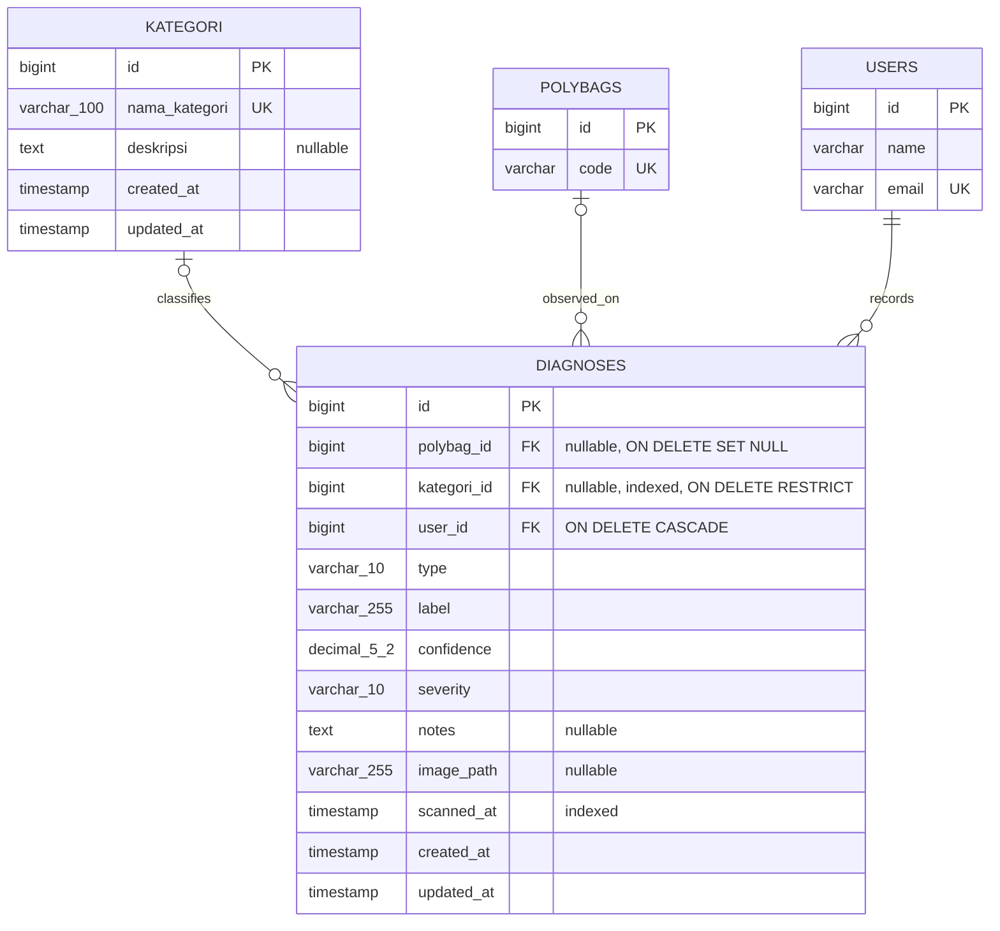

# Desain Database Master Kategori

> Dokumen ini adalah ringkasan terfokus untuk penilaian tugas. Acuan utama
> skema seluruh project adalah [`docs/backend/erd.md`](../backend/erd.md).
> Keduanya menggambarkan struktur kategori dan diagnosis yang sama; dokumen
> ini hanya membatasi diagram dan kamus data pada relasi yang relevan.

## Cakupan

Skema ini menambahkan tabel `kategori` dan foreign key opsional
`diagnoses.kategori_id`. Tabel akun, polybag, dan diagnosis yang sudah ada
dipertahankan. Migrasi baru bersifat aditif dan tidak menghapus data lama.

## Kamus data

### Tabel `kategori`

| Kolom | Tipe database | Constraint | Keterangan |
|---|---|---|---|
| `id` | BIGINT UNSIGNED | Primary key, auto-increment | ID kategori |
| `nama_kategori` | VARCHAR(100) | NOT NULL, UNIQUE | Nama master kategori diagnosis |
| `deskripsi` | TEXT | NULL | Keterangan kategori |
| `created_at` | TIMESTAMP | NULL oleh konvensi Laravel | Waktu pembuatan |
| `updated_at` | TIMESTAMP | NULL oleh konvensi Laravel | Waktu perubahan |

Kategori awal yang disediakan oleh `KategoriSeeder`:

1. Penyakit Daun
2. Penyakit Buah
3. Hama
4. Defisiensi Nutrisi
5. Tanaman Sehat

Seeder menggunakan `updateOrCreate` berdasarkan `nama_kategori`; aman
dijalankan ulang. Seeder dijalankan secara eksplisit, tidak dipanggil dari
`DatabaseSeeder`.

### Tambahan tabel `diagnoses`

| Kolom | Tipe database | Constraint | Keterangan |
|---|---|---|---|
| `kategori_id` | BIGINT UNSIGNED | Nullable, indexed, FK ke `kategori.id`, ON DELETE RESTRICT | Kategori diagnosis; null diizinkan untuk data lama/tanpa kategori |

Semua kolom diagnoses lainnya tidak diubah oleh migrasi kategori.

## ERD

Relasi kategori ke diagnosis adalah satu-ke-banyak: sebuah kategori dapat
digunakan banyak diagnosis; satu diagnosis memiliki nol atau satu kategori.
Definisi kolom diagnosis pada diagram ini mengikuti migrasi yang sama dengan
[`erd.md`](../backend/erd.md), termasuk FK polybag `SET NULL` dan FK user
`CASCADE DELETE`.

## Alasan keputusan desain

- **Nama unik:** mencegah duplikasi kategori master dan membuat pencarian
  serta pemilihan kategori konsisten.
- **`kategori_id` nullable:** menjaga kompatibilitas diagnosis lama dan
  mengizinkan hasil diagnosis yang belum diklasifikasikan.
- **`RESTRICT` saat kategori dihapus:** menjaga klasifikasi yang sudah
  terpasang pada diagnosis. API memeriksa relasi dan merespons 409 sebelum
  penghapusan; foreign key tetap melindungi integritas bila ada race.
- **Indeks foreign key:** mempercepat join/filter diagnosis berdasarkan
  kategori dan mendukung pemeriksaan constraint.
- **Tabel bernama `kategori`:** mengikuti materi tugas; model menetapkan nama
  tabel secara eksplisit.

## Migrasi

1. `2026_11_15_000000_create_kategori_table.php`
2. `2026_11_15_000001_add_kategori_id_to_diagnoses_table.php`

Jalankan `php artisan migrate` dari `web/`. Jangan menjalankan reset database
untuk menerapkan skema ini.
