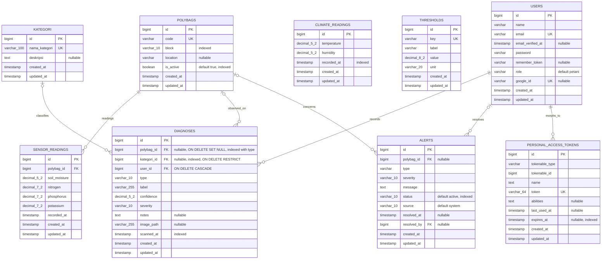

# Struktur Database Final Berry Care

**ERD ini adalah acuan utama (single source of truth) untuk struktur database
seluruh project Berry Care.** `docs/api/desain-database-kategori.md` adalah
tampilan terfokus untuk tugas Master Kategori; kolom, tipe, constraint, dan
relasi kategori/diagnosis di sana harus sama dengan bagian terkait di ERD ini.

Tabel domain sesuai migrasi Berry Care dan master kategori; tabel akun dan
autentikasi berasal dari migrasi Laravel/Sanctum yang lebih awal.

Struktur ini adalah baseline project, bukan skema yang tidak boleh berubah.
Perubahan kebutuhan selanjutnya harus dibuat melalui migrasi baru yang
kompatibel dengan data yang sudah ada. Jangan mengedit atau menghapus migrasi
yang sudah dijalankan pada database bersama/production.

## ERD inti

## Rincian tabel domain

| Tabel | Kolom penting | Kunci, indeks, dan perilaku relasi |
|---|---|---|
| `polybags` | `code` (unik), `block`, `location` nullable, `is_active` default `true` | Indeks pada `block` dan `is_active`. Menghapus polybag menghapus pembacaan sensor terkait; referensi diagnosis/alert menjadi `NULL`. |
| `sensor_readings` | `polybag_id`, `soil_moisture` decimal(5,2), N/P/K decimal(7,2), `recorded_at` | FK ke `polybags` dengan cascade delete; indeks gabungan (`polybag_id`, `recorded_at`). Data bersifat append-only melalui API. |
| `climate_readings` | `temperature`, `humidity` decimal(5,2), `recorded_at` | Indeks pada `recorded_at`. Data bersifat append-only melalui API. |
| `diagnoses` | `polybag_id` nullable, `kategori_id` nullable, `user_id`, `type` varchar(10), `label` varchar(255), `confidence` decimal(5,2), `severity` varchar(10), `notes`/`image_path` nullable, `scanned_at` | FK polybag `SET NULL`; FK kategori `RESTRICT ON DELETE`; FK user `CASCADE DELETE`; indeks `scanned_at`, gabungan (`polybag_id`, `type`), dan foreign key `kategori_id`. |
| `kategori` | `id` bigint unsigned PK, `nama_kategori` varchar(100) NOT NULL UNIQUE, `deskripsi` text nullable, timestamps | Master kategori diagnosis. Relasi satu-ke-banyak ke diagnosis; `diagnoses.kategori_id` nullable dan `RESTRICT ON DELETE`. |
| `alerts` | `polybag_id` nullable, `type`, `severity`, `message`, `status` default `active`, `source` default `system`, `resolved_at`/`resolved_by` nullable | FK polybag dan user resolver `SET NULL`; indeks `status` dan gabungan (`type`, `polybag_id`, `status`). |
| `thresholds` | `key` unik, `label`, `value` decimal(8,2), `unit` varchar(20) | Berisi lima threshold awal yang dimasukkan oleh migrasi domain. |

Semua tabel domain memiliki `id` bigint unsigned auto-increment serta
`created_at` dan `updated_at`, kecuali bila disebut berbeda di migrasi.
Kolom `code`, `type`, `severity`, `status`, dan `source` disimpan sebagai
string, bukan tipe `ENUM` database; nilai yang diterima dibatasi oleh
validasi aplikasi.

### Nilai threshold awal

| Key | Label | Nilai | Unit |
|---|---|---:|---|
| `humidity_max` | Kelembapan udara maksimum | 85 | % |
| `soil_moisture_min` | Kadar air tanah minimum | 45 | % |
| `nitrogen_min` | Nitrogen minimum | 30 | ppm |
| `phosphorus_min` | Fosfor minimum | 20 | ppm |
| `potassium_min` | Kalium minimum | 120 | ppm |

## Tabel platform dan autentikasi

- `users`: tabel akun yang sudah ada, dengan `role` default `petani` dan
  `google_id` nullable-unique sebagai tambahan migrasi autentikasi. `email`
  juga unik. Nilai role yang dipakai aplikasi adalah `admin` dan `petani`.
- `personal_access_tokens`: tabel Sanctum dengan relasi polymorphic
  `tokenable_type` + `tokenable_id`; relasi ini tidak memakai foreign key
  langsung ke `users`.
- `password_reset_tokens` dan `sessions`: tabel Laravel untuk reset password
  dan sesi web. `sessions.user_id` nullable dan terindeks, bukan foreign key.
- `cache`, `cache_locks`, `jobs`, `job_batches`, `failed_jobs`: tabel runtime
  Laravel; bukan bagian dari relasi domain kebun.
- Tabel kategori dan kolom `diagnoses.kategori_id` dibuat oleh migrasi
  aditif `2026_11_15_000000_create_kategori_table.php` dan
  `2026_11_15_000001_add_kategori_id_to_diagnoses_table.php`.
- Diagram terfokus dan kamus data untuk penilaian tugas ada di
  `docs/api/desain-database-kategori.md`; itu bukan skema alternatif.

## Validasi yang dijaga aplikasi

Validasi berikut berada di Form Request/API, bukan `CHECK` constraints pada
database: kadar air tanah dan kelembapan 0–100; N/P/K 0–1000; suhu -10–60 °C;
confidence 0–100; waktu pembacaan/pemindaian tidak lebih dari lima menit di
masa depan. Karena itu semua jalur penulisan data harus melewati validasi
aplikasi.

## Keputusan integritas data

- Menghapus polybag menghapus riwayat sensor miliknya, tetapi tidak menghapus
  diagnosis atau alert; relasi polybag pada kedua tabel tersebut menjadi
  `NULL`.
- Menghapus user menghapus diagnosis yang dibuat user. Referensi user pada
  alert yang sudah diselesaikan menjadi `NULL`.
- Pembacaan sensor dan iklim tidak memiliki operasi edit/hapus API agar
  riwayat pengukuran tetap append-only.
- Deduplikasi dan auto-resolve alert sistem dilakukan oleh service aplikasi;
  database belum memiliki unique constraint khusus untuk deduplikasi alert.

## Migrasi

Tabel domain ditambahkan secara aditif agar tabel akun/auth yang sudah ada
tetap dipertahankan. Untuk memeriksa status migrasi tanpa mengubah data,
jalankan `php artisan migrate:status` dari folder `web/`.
